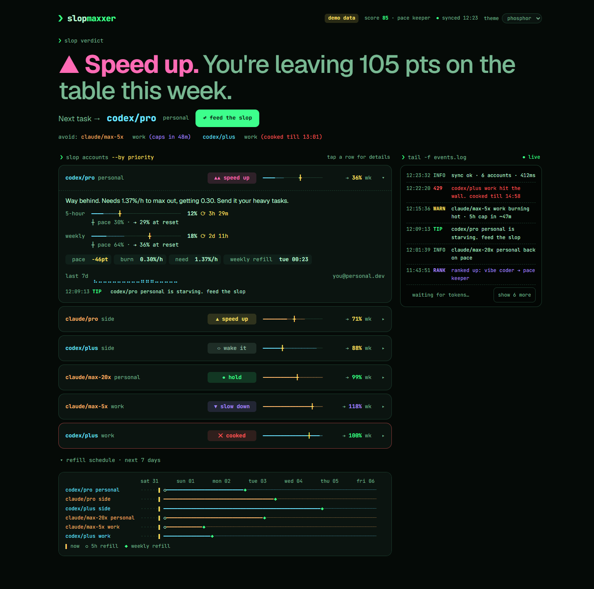
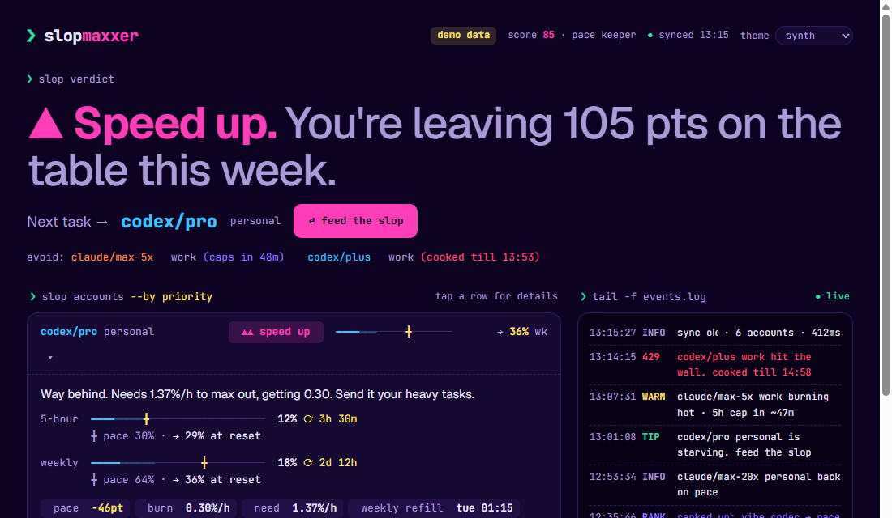
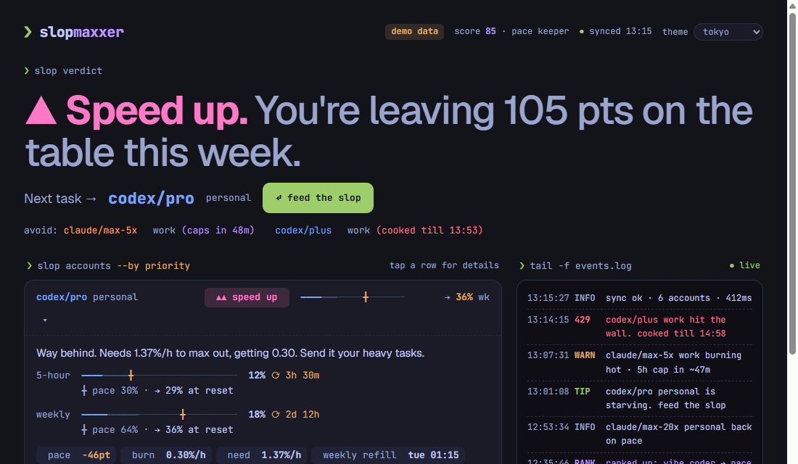
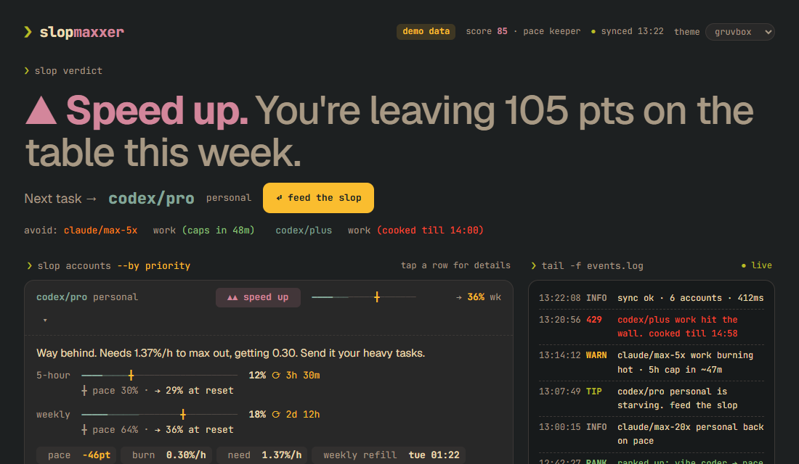
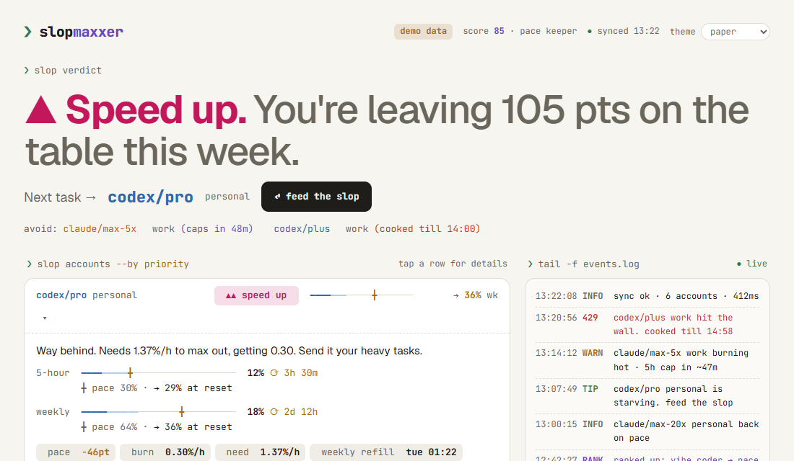
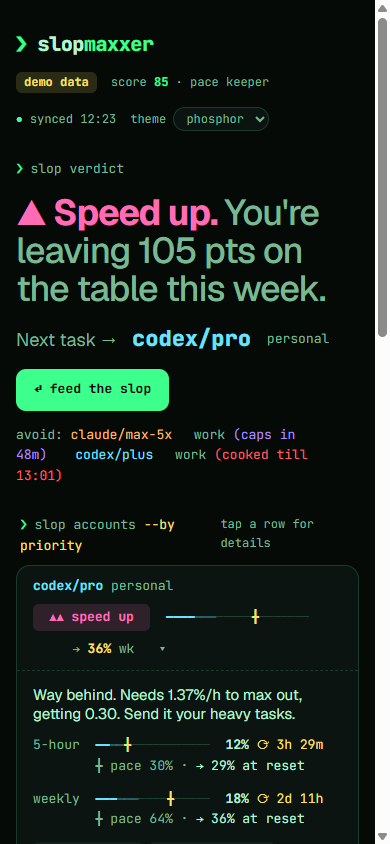

<div align="center">

```
 ❯ slopmaxxer
```

# SlopMaxxer

### every token unused is a token wasted

**One local dashboard for every Claude Code and Codex account on your machine.**<br>
It shows where you can work next, which capacity expires soon, and what might interrupt you.

</div>

## quick start

Needs **Node.js 20+** (including npm/npx) and an existing Claude Code or Codex login.
Run this from your home folder or another folder outside the SlopMaxxer source checkout:

```sh
npx slopmaxxer@latest
```

Accept the installation prompt if shown. Your browser opens automatically, and the terminal
prints a clickable dashboard link. If port 4747 is occupied, SlopMaxxer picks a free port.
**Keep the terminal open. Press Ctrl+C to stop.** No clone, global install, or npm account needed.

**Using Safe-chain?** If it blocks a freshly published release because of its minimum package age,
you can wait for that age requirement or skip the age check for this invocation:

```sh
npx --safe-chain-skip-minimum-package-age slopmaxxer@latest
```

**Already inside the source checkout?** Use `npm start` there. To test the published npm package,
run `cd ~` first, then the `npx` command above. This avoids npm selecting the local source package.

<div align="center">




</div>

---

## the problem

You pay for Claude **and** ChatGPT. Maybe a few of each: work, personal, the side-project one.
Every one of them has a 5-hour window and a weekly cap, and every one of them resets on its own schedule.

On Monday you're rate-limited on one, and on Sunday another resets with 70% unused. **That's money on the floor.**

## the fix

```sh
npx slopmaxxer@latest
```

SlopMaxxer finds your logins, reads their limits, and recommends a suitable account with capacity:

> ### ▲ Speed up.
> 60% of its 5-hour allowance remains, resetting in 45 minutes. Use it for suitable work before reset.

No setup. No accounts to add. No API keys. It just reads what's already there.

---

## ✨ what you get

| | |
|---|---|
| **Use next** | One actionable recommendation, with a provider filter and the reason |
| **Capacity now** | Remaining percentage and reset time for each applicable limit, including model restrictions |
| **Use before reset** | Meaningful capacity nearing reset gets priority over a speculative weekly forecast |
| **Interruption estimates** | Conditional ranges from sufficiently recent, consistent readings; never a task-size guarantee |
| **Completed windows** | At least how much was used and at most how much remained, with the last-reading gap disclosed |
| **Weekly outlook** | A limited-confidence demand range only after enough well-observed days; offline gaps are not inactivity |
| **History and events** | Daily usage, observed availability changes, and reset confirmations |
| **Six themes** | phosphor, tokyo, gruvbox, paper, synth, graphite |

The screenshots below show the earlier score-based design; current guidance uses availability and reset opportunities.

<div align="center">
 
 
</div>

---

## commands

| command | does |
|---|---|
| `npx slopmaxxer@latest` | open the dashboard |
| `npx slopmaxxer@latest --demo` | try sample accounts without logging in |
| `npx slopmaxxer@latest status` | terminal summary |
| `npx slopmaxxer@latest status --json` | snapshot plus the same guidance used by the dashboard |
| `npx slopmaxxer@latest status --provider claude` | recommendations for a specific provider |
| `npx slopmaxxer@latest status --demo` | terminal demo without reading credentials |
| `npx slopmaxxer@latest accounts` | list discovered logins |
| `npx slopmaxxer@latest --help` | show help |
| `npx slopmaxxer@latest --version` | print the version |

Startup prints a clickable browser link. If the default port is occupied, SlopMaxxer automatically
uses a free port and prints its URL. Keep the terminal open while using the dashboard.
Use `--port 4748` to require a specific port, or `--no-open` to open the printed link yourself.
No accounts found? Run `claude` or `codex login` first.
`@latest` requests the latest release; `@0.1.1` selects a specific version.
To install once, use `npm install -g slopmaxxer`, then run `slopmaxxer`.

### run from source

There are no dependencies to install:

```sh
git clone https://github.com/JohanBellander/SlopMaxxer.git
cd SlopMaxxer
npm start                        # opens the dashboard and prints its URL
```

| command | does |
|---|---|
| `node bin/slopmaxxer.mjs` | the dashboard |
| `node bin/slopmaxxer.mjs --demo` | the dashboard with 6 fake accounts covering every state |
| `node bin/slopmaxxer.mjs status` | one-shot terminal view, for the true terminal enjoyers |
| `node bin/slopmaxxer.mjs status --json` | the same, for scripts |
| `node bin/slopmaxxer.mjs accounts` | which logins were found, and where |
| `npm link` | get a global `slopmaxxer` command |

Flags: `--port 4747`, `--no-open`.

Maintainers: see [the release checklist](docs/releasing.md).

---

## 🔍 how it finds your accounts

Like T3 Code, it picks up whatever is installed:

- `~/.claude` and `~/.codex`
- `CLAUDE_CONFIG_DIR` / `CODEX_HOME` if set
- extra logins in sibling folders: `~/.claude-personal`, `~/.codex-work`, `~/.claude2`, …
- anything you list in `~/.slopmaxxer/config.json`

Claude usage first comes from Claude Code's own `cachedUsageUtilization` in `~/.claude.json`
(or `.claude.json` inside a custom Claude config directory). No status-line setup is needed.
The reading must match the logged-in account, be less than one hour old, contain valid session
and weekly percentages, and have no elapsed window resets. These are cached readings with their
original timestamp, not new samples. Claude's files are only read, never modified.

When that local reading is unavailable or outdated, SlopMaxxer falls back to the usage API.
API readings are cached for five minutes in the state directory (`~/.slopmaxxer/claude-usage/`
by default). Instances sharing that directory reuse readings and coordinate requests, including manual
refreshes. HTTP 429 responses trigger exponential backoff from five minutes up to one hour; a longer
`Retry-After` is honored. Cached readings show their timestamp and are not counted as new usage samples.
Readings older than 12 hours are discarded. Local Claude transcripts still provide estimated history,
not authoritative remaining limits. Restart older instances with the updated version to use this cache.

**Got more accounts?** Log each one into its own folder and it shows up on the next poll:

```powershell
# PowerShell
$env:CLAUDE_CONFIG_DIR = "$HOME\.claude-personal"; claude        # then /login
mkdir $HOME\.codex-personal; $env:CODEX_HOME = "$HOME\.codex-personal"; codex login
```

```sh
# bash / zsh
CLAUDE_CONFIG_DIR=~/.claude-personal claude
mkdir -p ~/.codex-personal && CODEX_HOME=~/.codex-personal codex login
```

The same login found in two folders shows up once. The same email in two orgs (say, two Team plans) shows up twice,
because those are different limits.

## 📡 where the numbers come from

| | live limits | 7-day history |
|---|---|---|
| **Claude** | the usage endpoint behind `/usage`, using the token Claude Code stored | transcripts in `projects/`: tokens weighted by model price, calibrated on your live weekly %. **Estimated**, shown as `~` |
| **Codex** | the usage endpoint behind `/status`, using `auth.json` | session logs in `sessions/`, which record every limit status the server sent. **Exact** |

After that, SlopMaxxer records its own readings every ~2 minutes and uses those.
If a live read fails (a 429, an expired token), the account keeps its last reading, flagged as stale.

> These are the same calls the official CLIs make. They aren't public APIs, so they can change without notice.

## 🔒 is this safe?

- **Read-only.** It never refreshes, rewrites or moves a credential, so it can't break your CLI logins.
- **Local only.** The server binds to `127.0.0.1`. Your tokens only ever go to Anthropic and OpenAI, the same as with the CLIs.
- **Not an account switcher.** It tells you where to go. You decide whether you go.
- **Zero dependencies.** Nothing in `node_modules` can go wrong, because there is no `node_modules`.

---

## how recommendations work

The dashboard and terminal share one decision engine. A recent burst does not mean you must slow down:
using up a window before reset can be a good outcome.

| Message | Meaning |
|---|---|
| **Available** | Fresh readings show capacity on the applicable limits |
| **Use before reset** | Meaningful allowance is left near a reset; use it for suitable work |
| **Ready to start** | A window has not opened yet and other limits allow use |
| **Limited headroom** | 10% or less remains on an applicable limit; small tasks may still fit |
| **Model restriction** | General allowance remains, but a model-specific limit needs attention; inspect the reported model limits |
| **Allowance used up** | A limit is exhausted; recovery must satisfy every blocking window |
| **Checking reset** | A reset time passed; fresh confirmation is required |
| **Refresh needed / no reliable data** | Old, missing, or failed readings cannot justify a recommendation |

The provider filter constrains routing. A known model restriction is surfaced
rather than silently recommending an unverified alternative. Percentages from different plans are never
added together or presented as interchangeable token counts.

Forecasts use at least 30 minutes and four observations from the same window, without gaps over ten minutes.
Only supported cap estimates within two hours are shown, explicitly conditional on the recent pace continuing.
Weekly demand estimates need at least five completed UTC days with 18 hours of observed coverage each,
within the last fourteen days. They are contextual ranges, never instructions to stop or guarantees of task cost.
Until enough evidence exists, the app says it is learning your usage.

Completed reset statistics are **bounds**, not exact measurements: the last pre-reset reading establishes
at least the amount used. Its time gap is displayed. The availability interval counter records only short,
observed periods where one account was limited and another reported capacity. It is not lost work time,
and it does not establish that the other account suited your task. Credits and paid extra usage stay separate.

**Direction indicators:** ▲ **Speed up** means at least 20% allowance remains and its remaining percentage exceeds the window’s remaining time by at least 20 percentage points; ▲▲ **Speed up** means usable allowance is nearing reset; ▶ **Keep cooking** means capacity remains; ▼ **Slow down** means the recommended account has little headroom; ▼ **Cooldown** means all matching accounts are capped. These messages follow the recommended account, never an average across subscriptions.

See [the decision model](public/guidance.js) and [scenario tests](test/guidance.test.mjs).

## ⚙️ config (optional)

`~/.slopmaxxer/config.json`:

```json
{
  "pollSeconds": 120,
  "extraClaudeDirs": ["D:/accounts/claude-side"],
  "extraCodexDirs": [],
  "ignoreDirs": ["C:/Users/me/.claude-old"],
  "nicknames": { "claude:me@work.com": "work", "codex:me@gmail.com": "personal" }
}
```

Nicknames become the row labels (`claude/team-5x work`). State lives in `~/.slopmaxxer/`:
`history.jsonl` (35 days of percentage readings), `events.jsonl` (the log), `state.json`.

---

## 🛠️ hacking on it

```sh
npm test        # node --test, no framework
node bin/slopmaxxer.mjs --demo --port 4748
```

```
bin/slopmaxxer.mjs      CLI: serve · status · accounts
src/discover.mjs        finds installs
src/providers/          claude.mjs · codex.mjs (live reads)
src/collect.mjs         polls (on demand, while a dashboard is open), dedupes, stores readings
src/backfill.mjs        history from session logs and transcripts
src/snapshot.mjs        → the SlopSnapshot the UI eats, plus the event log
src/server.mjs          127.0.0.1 server: /api/slop, /api/snapshot
public/guidance.js      shared availability, messages and routing
public/slop.js          glyph meters and display helpers
src/history.mjs        confidence, demand outlook and completed windows
public/index.html       the dashboard (also served at /classic)
design/                 the Claude Design handoff this UI was built from
```

<div align="center">


<br>

**works on your phone too, for checking your slop from bed.**

<br>

*Design by Claude Design · built with Claude Code · fuelled by tokens that would otherwise have expired*

```
▎ waiting for tokens…
```

</div>
